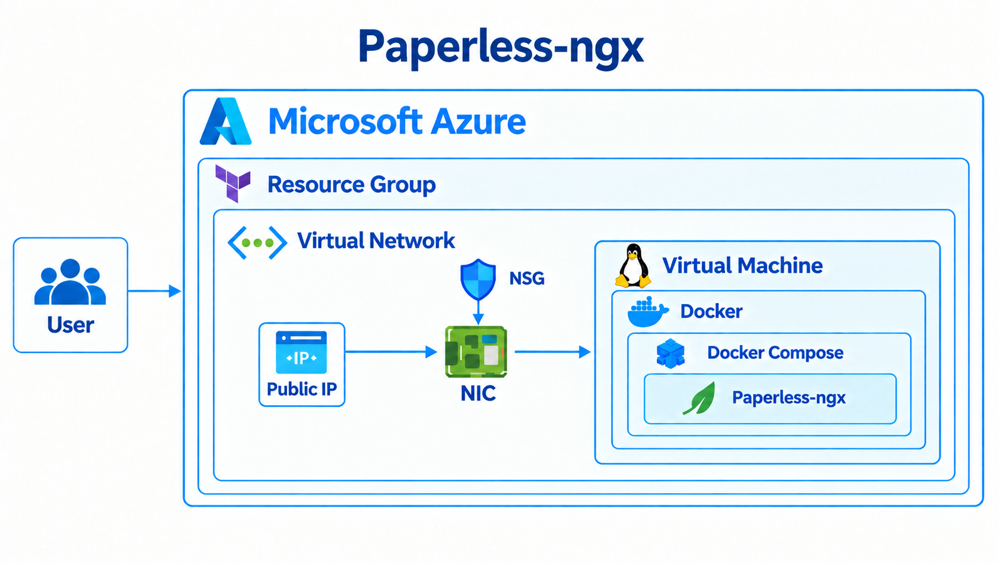

# Architecture

The project infrastructure was provisioned on Microsoft Azure using Terraform. After the infrastructure was created, we accessed the Linux virtual machine and installed Docker and Docker Compose. Paperless-ngx was then deployed using this containerized setup. The platform supports document storage, organization, search, and OCR.