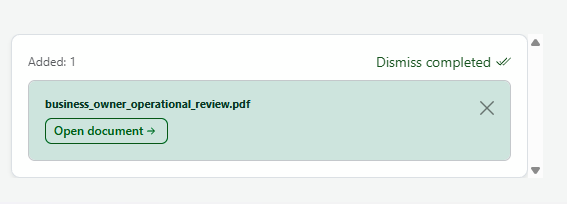
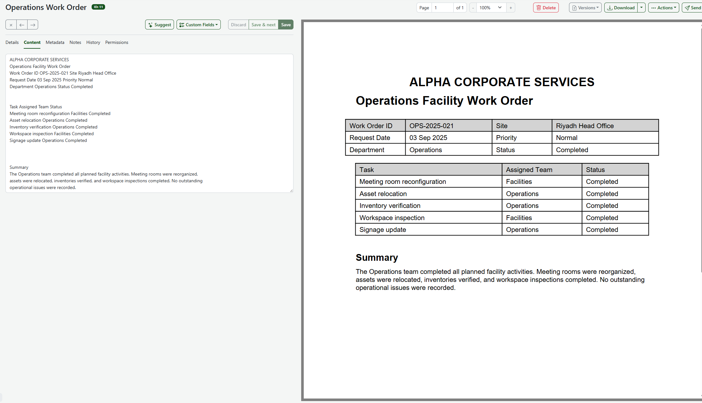
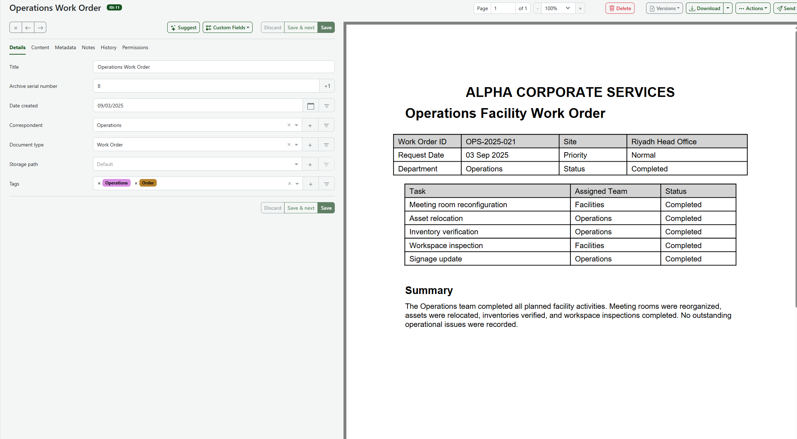
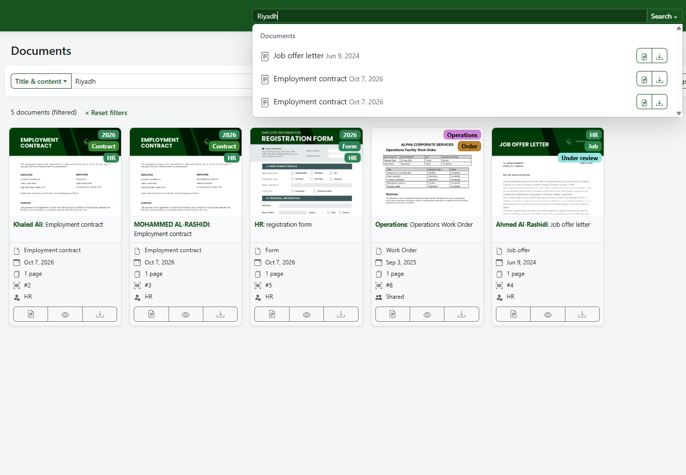
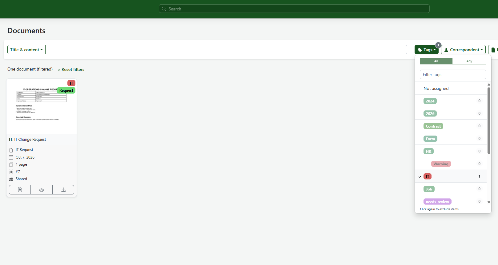
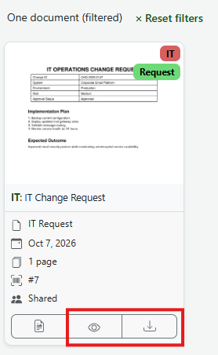

# Document Workflow – Paperless-ngx (IT & Operations)

**Project:** CC-RCP-11 – Internal Document Management and Automation Platform
**Scope of this document:** How staff upload, classify, search, and retrieve documents in Paperless-ngx, with worked examples from the IT and Operations areas.

## 1. Purpose

Paperless-ngx gives the company one central archive for business documents. Instead of files scattered across shared folders, email, and local devices, staff upload each document once. The system extracts its text (OCR), stores its metadata, and makes it searchable.

## 2. Who uses it

| Area | Example documents | Responsible |
|---|---|---|
| IT | Change requests, incident reports | IT |
| Operations | Work orders, operational reviews | Operations |
| HR | Contracts, leave forms | HR |
| Finance | Invoices, receipts | Finance |

## 3. Workflow steps

### Step 1 – Upload
1. Log in to Paperless-ngx.
2. On the Documents page, choose **Upload new documents** and select the file (or drag it in).
3. A notification confirms the upload and processing begins.

### Step 2 – Processing and text extraction (OCR)
Paperless-ngx processes the file, stores it in the archive, and extracts its text. When processing finishes, the document appears in the document list. The extracted text is shown on the **Content** tab of the document.

*Content tab of document ID 11 showing the extracted text (work order OPS-2025-021).*

> Note: the sample documents are text-based PDFs, so Paperless reads their text directly. For a scanned example, see Section 6.

### Step 3 – Classification
Open the document and set its metadata on the **Details** tab: title, date, correspondent, document type, and tags. Save the changes.

*Details tab of document ID 11.*

Worked examples from this project:

| ID | Title | Correspondent | Type | Tags | Date |
|---|---|---|---|---|---|
| 10 | IT Change Request | IT | IT Request | IT, Request | 2026-10-07 |
| 11 | Operations Work Order | Operations | Work Order | Operations, Order | 2025-09-03 |
| 19 | Business Review | Operations | Review | needs-review, Operations, Report | 2026-10-07 |

The work order's date (3 Sep 2025) comes from the document itself. The change request and the review print no date, so Paperless used the upload date.

### Step 4 – Search and filter
Documents can be found by text or by metadata.

| Goal | How | Expected result |
|---|---|---|
| Find a document by content | Type `CHG-2025-0147` in the top search bar | IT Change Request (ID 10) |
| Find a document by a site or ID | Search `Riyadh` or `OPS-2025-021` | Operations Work Order (ID 11) |
| List one area's documents | Filter by tag `Operations` | Operations Work Order, Business Review |
| List documents waiting for review | Filter by tag `needs-review` | Business Review |
| List one kind of document | Filter by document type `IT Request` | IT Change Request |

> Note: the search by text result

> Note: the filter by tag result

### Step 5 – Retrieval and review
Open the document to preview it, or download the original file. For reviews and audits, filter by `needs-review`, open each document, and remove the tag when the review is complete.

## 4. Example business scenarios

**IT change tracking.** IT uploads the change request for the corporate email platform (CHG-2025-0147). It is tagged `IT` and `Request`. Later, an auditor searches for the change ID and finds the approved request with its implementation plan.

**Operations records.** Operations uploads the facility work order for the Riyadh Head Office (OPS-2025-021). It is tagged `Operations` and `Order`. A manager filters by `Operations` to see completed work.

**Leadership review.** The business operations review is tagged `needs-review`. Leadership filters by that tag to see which documents are waiting for attention.

